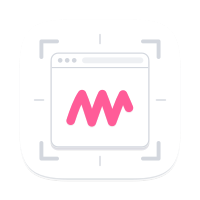
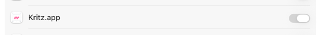

<div align="center">



# Kritz

**A lightweight, native screenshot annotation app for macOS. An open-source replacement for the discontinued Skitch.**

No cloud. No login. No subscription. Capture → mark up → copy or save. Done.

[](#requirements)
[](#requirements)
[](#building-from-source)
[](LICENSE)

[**Download**](../../releases/latest) · [Features](#features) · [Build from source](#building-from-source) · [Roadmap](#roadmap)

</div>

---

## Why

[Skitch](https://en.wikipedia.org/wiki/Skitch) hasn't been meaningfully updated since 2020. It only runs under Rosetta on Apple Silicon and relied on an Evernote account. Kritz brings back the workflow a lot of people used every day (grab a region, slap an arrow or some text on it, copy it) as a small, fast, **fully native** app that keeps everything on your Mac.

## Features

- **Own crosshair capture overlay**: dims the screen, shows live dimensions, `Esc` cancels. Kritz moves itself out of the way so it never covers your shot.
- **Timed capture**: draw the region first, then a visible countdown runs (time to open a menu, hover a tooltip, and so on) with a tick sound, then it fires.
- **Annotate**: arrow, text, rectangle, ellipse, highlighter, and a freehand-friendly toolset.
- **Select tool**: click a placed element to **move and resize** it (arrows get start/end handles), `⌫` deletes.
- **Copy & paste**: `⌘C` copies the result; `⌘V` pastes an image from the clipboard as a movable element.
- **Step counter badges**, **ruler / measuring tool** (px), and **spotlight** to focus attention.
- **Color eyedropper**: pick any on-screen color as the draw color (HEX also goes to the clipboard).
- **OCR** (Apple Vision, offline) and **QR code reading** (CoreImage) straight from the screenshot.
- **Pixelate** sensitive information (CoreImage).
- **Crop** with a Skitch-style frame: 8 handles, rule-of-thirds grid, live dimensions, Apply/Cancel (`⏎` / `Esc`).
- **Draw past the edge** and the canvas grows with a white background instead of clipping.
- **Full undo/redo** for annotations *and* crop (`⌘Z` / `⇧⌘Z`).
- **Shutter sound** on capture, **repeat last area** (`⇧⌘R`), **PNG & JPEG export**.
- **Tidy UI**: a top bar (highlighted, centered capture + timer, undo/redo, copy/save) and a left tool palette, with the screenshot centered.
- **15 languages**: en, de, es, fr, it, pt-BR, nl, ru, zh-Hans/Hant, ja, ko, ar, hi, tr, pl. Kritz follows your system language.
- **Native Apple Silicon** (arm64), built in Swift/AppKit, not Electron.

## Requirements

- macOS 14 (Sonoma) or newer
- Apple Silicon (arm64)

## Install

1. Download `Kritz.dmg` from the [latest release](../../releases/latest).
2. Open the DMG and drag **Kritz** into **Applications**.
3. Launch it. On first run macOS asks for the **Screen Recording** permission, which Kritz needs to capture your screen.
4. Open *System Settings → Privacy & Security → Screen Recording* and turn the switch next to **Kritz** on:

   

5. Relaunch Kritz. Without this permission the capture stays blank.

The release DMG is **signed with a Developer ID and notarized by Apple**, so it opens without any Gatekeeper warning.

## Building from source

Kritz is a Swift Package Manager executable plus a small script that assembles the `.app` bundle.

```bash
git clone https://github.com/jojacobsen/Kritz.git
cd Kritz

# compile only (fast, for development)
swift build

# build the .app bundle (+ icon, localizations, ad-hoc signature)
./build-app.sh

# build and launch
./build-app.sh run
```

Open `Package.swift` directly in Xcode to build and debug the executable target there.

### Shortcuts

| Action | Shortcut |
|---|---|
| New screenshot | `⌘N` |
| Timed capture | *File → Timed Capture* |
| Undo / Redo | `⌘Z` / `⇧⌘Z` |
| Copy image | `⇧⌘C` |
| Save | `⌘S` |
| Repeat last area | `⇧⌘R` |

## Project structure

```
Sources/Kritz/
  main.swift                   App entry point
  AppDelegate.swift            Menu, capture trigger, window management
  CaptureController.swift      Screen capture (screencapture + own crop)
  SelectionOverlay.swift       Crosshair region overlay + countdown
  CanvasView.swift             Drawing surface: annotations + export
  EditorWindowController.swift Editor window + toolbar
  Recognition.swift            OCR (Vision) + QR (CoreImage)
  Models.swift                 Annotation model, Tool enum
  Localization.swift           L("…") string helper
Localization/<lang>.lproj/     Translations (15 languages)
Assets/                        App icon (SVG source + compiled .icns)
build-app.sh                   Build the .app bundle + sign
```

## Localization

UI strings go through the `L(...)` helper. Translations live in `Localization/<lang>.lproj/Localizable.strings` and are copied into the bundle by `build-app.sh`. English is the key itself (no table entry needed).

**Add a language:** create `Localization/<code>.lproj/`, copy `Localizable.strings` from an existing language, translate, rebuild. Kritz follows the system language setting.

## Roadmap

- [x] Developer ID signing + Apple notarization (clean Gatekeeper install)
- [ ] Multi-monitor selection (one overlay per screen)
- [ ] Global hotkey (capture system-wide, even when Kritz isn't focused)
- [ ] Menu-bar app mode (`LSUIElement`)
- [ ] Drag-and-drop the result into other apps
- [ ] Pin to screen (always-on-top) · WCAG contrast checker
- [ ] Scrolling capture · nicer export backdrops
- [ ] Mac App Store build (sandbox + ScreenCaptureKit)

## Contributing

Issues and pull requests are welcome. For UI strings, please keep the English key and add/adjust the matching `.lproj` entries.

## License

[MIT](LICENSE) © 2026 Johannes Jacob
